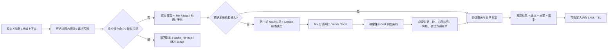

# 架构

代码负责候选和结构约束，Jev 仅是可替换、可单独评测的判定器。阶段一上限为 128 个 Unicode
codepoint；没有篇章 NER、实体链接或地理编码实现。



## 模块与数据边界

| 模块 | 责任 |
|---|---|
| `models` | 严格请求 schema、分层结果、偏移和证据 |
| `lexicon` | 验证词库 schema、有效期过滤、Trie 匹配（含别名） |
| `candidates` | 字符位置节点；边只引用原文连续子串；单字保证可达 |
| `questions` | 每个字符间隙的 Noul；类型 Choice；显式标记及独立问题语义 |
| `providers` | 可注入 Judge 协议、真实 SDK、合成 mock、纯本地适配器 |
| `decoder` | 精确 DAG k-best 动态规划，确定性去重与同分排序 |
| `components` | 父单元局部词图、第二轮角色判定、全局偏移还原 |
| `service` | 快速通道、两轮编排、回退、歧义、最终结构验证 |
| `cache` | 规范化哈希键、内存 LRU/TTL、统计、进程内限流与请求预算 |
| `api / cli` | HTTP 与可安装命令入口 |
| `evaluation` | 独立路线和基础指标；禁止把真实接口失败记为 Jev 成绩 |

## 无损处理与候选召回

预处理采用原文身份映射，不 trim、不合并空白、不作会改变长度的预先替换。
Python 字符串索引就是 API 约定的 Unicode codepoint，不是 UTF-8 字节、UTF-16 单元或 grapheme。
NFKC 仅用于输出的独立规范名字段，别名只在原始 surface 上匹配。

候选来源为完整/别名词库、jieba（`HMM=False`）、地名后缀与门牌规则、最长 16 字的未知子串、
单字兜底。词库匹配不受未知子串长度上限影响。后缀只提出候选，不能直接证明实体存在。
规则负例抑制明显机械误判，但它们不是完整的非实体识别器。

快速通道只匹配 `verified_inputs.json` 的完整原文和已核验 input_kind，要求记录的 SHA-256
与当前完整词库内容一致，并核对有效词库边及成分仍可覆盖。词库变更须重新核验并更新记录，
不可仅复制新指纹冒充核验。有地域上下文时
退出快速通道。不能因为 jieba 的输出看起来合理，就称之为“本地已验证”。

## 判定设计

第一轮对每个原文间隙构建 Noul，用 `⟦CUT⟧` 展示目标位置；数字索引仅由代码使用。
原文若含同名标记，仅在模型显示视图转义，不修改源文本。
另对最多 48 个候选（含词库命中）问实体类型 Choice，选项包含 `unknown` 和 `not_entity`。
每题用 `⟦span⟧...⟦/span⟧` 标记候选，并包含候选自身与左右语境，地域上下文放在 state，ID 不承担模型语义。

第一轮所有问题互不依赖。SDK 在单请求内并行回答，程序再以固定问题数分块、有界并行。
默认批 24、并行 4；每轮总时限 20 秒，SDK 最多一次重试。校验返回模型必须为 `jev-1.13.0`，
Noul 必须是有限的 [0,1] 数；Choice 必须覆盖原选项、分布近似和为 1，所选项必须为最大概率选项。
任一分块失败会取消本轮其他请求，再由服务整体回退本轮；失败分块可能已产生费用，
响应的 token 数仅统计成功完成的轮次，不是计费账单。

第二轮在父单元确定之后编译其内部边界和角色；规范词库已有完整人工成分且当前类型未被模型重新分类时跳过该部分。
父单元局部坐标在程序中转成原文绝对坐标。接近同分的局部方案用 Choice 竞争，包含弃权选项；
只可重排已有合法路径。模型不生成分词文本、不计算位置、不负责最终覆盖约束，也不用 Score
作为主决策。

## 评分与硬约束

设路径 P 的边界集合为 B，间隙概率为 p，边特征为 f：

```text
score(P) = Σ(edge ∈ P) f(edge)
         + Σ(gap ∈ B) log(p_gap)
         + Σ(gap ∉ B) log(1 - p_gap)
         + 0.7 × Σ(已询问候选) log(P_Choice(被选类型/角色))
```

边界尚无中文域拟合器，使用恒等映射，版本为 `identity-not-fitted-v1`。
边界 0/1 在评分时裁剪至 `[1e-6, 1-1e-6]`，原始值原样保留。
词库长度、别名、构词与本地分词来源影响 f；全部是可替换的未调优工程权重。
相邻边只能首尾连接，因此覆盖、不重叠、不丢字由路径结构保证；成分图在父范围内构造，
最终再验证每个原文切片、唯一 ID 和父子关系；即使未要求成分，已返回的成分也须完整覆盖父单元。没有省→市→区→道路这样的不可违反语法。

内部 DAG 去重键是 span/type 路径；同一切分但类型不同可以是不同候选。
路径原始分保留，第二轮 Choice 重排后主结果不一定具有最高原始分。
`top_k` 包含主方案，服务内部至少保留两条用于检测竞争，不会为凑数量编造备选。

## 置信度、降级与演进

模型原始 Noul / Choice distribution / Choice confidence 分别保留。mock 输出存另一字段。
接受分尚未拟合，固定 null；不把路径能量、Choice concentration 或 softmax 伪称为任务正确率。
当前歧义触发器为前两路径差值小于 0.8、未知类型/角色、选中单元类型因预算未被复核或局部方案弃权，阈值尚未验证。
第二轮重排不会自动消除第一轮的竞争提示。

服务当前为本地开发用 FastAPI；资产随 wheel 分发，无数据库、地址日志或实体解析服务。
**D 缓存骨架已实现（默认关）**：每个 Segmenter 持有纯内存 LRU/TTL，缓存最终完整结果，
读写均深拷贝。键由 canonical JSON + SHA-256 生成，包含完整请求（含空上下文、粒度、top_k）、
全部 Settings、响应版本清单（含边界校准、模型）、实际 backend、词库/规则/核验输入内容指纹及
词条有效期所用 UTC 日期。`versions()` 是响应与键的共同版本来源；已加载资产变更后 miss，
更换词库名称/别名须重建 Lexicon，磁盘资产更新须重新加载/重启。缓存不合并同时发生的 miss。
命中以 `diagnostics.cache_hit=true` 标记，跳过全部编排；本次调用量/token 归零，生成时计数
保存在 `cache_origin`。`engine.cache.stats()` 提供 hits/misses/entries/evictions/expirations；
关闭时 cache 为 None（若曾开启则保留但不访问）。mock/local 的 degraded 可缓存，上游失败不缓存。

可选滑动窗口限流和累计请求预算在查缓存前准入，超限抛出 `LocalLimitError`，HTTP 返回
429 和固定错误码，不含原文。默认进程内共享计数，禁用时不计数；启用后每个准入请求（含命中）
消耗一次预算，失败不退款，进程重启清零，`engine.limits.stats()` 可读接受/拒绝计数。
部署应使用统一的窗口配置；不同窗口首次启用时从当时开始计数。不跨 worker 协调，预算按请求数
而非 token/金额。本轮无缓存落盘和地址日志；连接池复用、生产鉴权、熔断、实际成本预算、
负载测试、生产观测、多层剪枝与漂移监测仍待后续。
强模型/中文专用分词器可通过 Judge 或候选模块替换接入，需在 B 阶段用相同数据比较。

## 评测资产与分组

金标准将两个粒度嵌套保存。`gold.validate_dataset` 检查 ID 唯一及正式数据的 place_groups
不跨 train/dev/test；同名、别名和名称族需由标注者分配同一组，程序不推断实体链接。
评测先验证整个文件，再按 `--split` 选择子集。成分角色 Macro-F1 在出现于预测或标注的角色上
等权平均，命中要求父跨度、成分跨度、角色完全一致；另报不含角色的父内跨度 F1。
DAG 的 gold_path_reachable_rate 衡量全部金标准单元能否同时组成完整路径。

生产缓存治理、数据保留和隐私策略尚待 D。公开演示与合成样例用于仓库测试；私人地址不应写入
演示金标准或共享报告。显式启用 jev 时会发送请求原文，部署方需决定鉴权、脱敏与保留策略。
